# 게임 상식 퀴즈

Python으로 만든 터미널 퀴즈 게임. 문제를 풀고 추가하거나, 목록과 최고 점수를 확인할 수 있도록 구성.

- **주제:** 언차티드, 툼 레이더, 갓 오브 워, 더 라스트 오브 어스
- **선정 이유:** 익숙한 게임 문제를 사용해 Python 기본 문법과 프로그램 흐름 학습에 집중
- **구현:** 기본 기능 5개(퀴즈 풀기·추가·목록·점수 확인·종료)

익숙한 게임을 주제로 터미널 퀴즈 제작. 메뉴에서 퀴즈 풀기·추가·목록·점수 확인 가능. 결과는 파일에 저장해 재실행 시에도 유지.

## 수행 체크리스트

| 수행 항목 | 확인 | 바로가기 |
|---|:---:|---|
| 개발 환경·실행 명령어 | ✅ | [1. 환경 및 실행](#1-개발-환경-및-실행) |
| Python 파일 구성·클래스 2개·제작 과정 | ✅ | [2. 파일과 제작 과정](#2-파일-구조와-역할) |
| 기본 퀴즈 5개·풀기·추가·목록·점수 | ✅ | [3. 기본 기능](#3-기본-기능-및-실행-결과) |
| 잘못된 입력·안전 종료 | ✅ | [4. 오류 처리](#4-입력-오류-및-안전-종료) |
| JSON 저장·재실행·파일 복구 | ✅ | [5. JSON 저장](#5-json-저장-및-복구) |
| Git 커밋·브랜치·7종 명령어·clone/pull | ✅ | [6. Git 실습](#6-git--github-실습) |
| 프로젝트 파일 구성 | ✅ | [7. 파일 구성](#7-프로젝트-파일-구성) |

*오른쪽 바로가기를 누르면 README의 해당 설명으로 이동.*

## 1. 개발 환경 및 실행

| 항목 | 내용 |
|---|---|
| 환경 | Windows / PowerShell / VS Code |
| 언어 | Python 3.10 이상 (실습 확인: Python 3.12.8) |
| 라이브러리 | `json`, `pathlib` (Python 기본 제공) |
| 버전 관리 | Git / GitHub |

**처음 실행**

```powershell
git clone https://github.com/hyeonla906/codyssey-python-quiz.git
cd codyssey-python-quiz
py main.py
```

- `git clone`: 저장소 복사 / `cd`: 폴더 이동 / `py main.py`: 게임 실행

**환경·문법 확인**

```powershell
py --version
py -m py_compile .\main.py .\quiz.py .\quiz_game.py
```

- `py --version`: Python 버전 확인 / `py -m py_compile`: 코드 문법 검사 (오류 없으면 출력 없음)

Windows·VS Code에서 코드 작성, PowerShell에서 `py main.py`로 게임 실행. Python 표준 라이브러리 사용.

<p><a href="docs/screenshots/environment.png">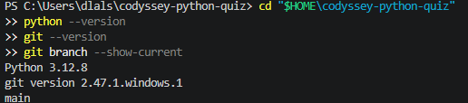</a></p>


## 2. 파일 구조와 역할

| 파일 | 역할 |
|---|---|
| [main.py](main.py) | 메뉴 표시, 번호 입력, 오류 처리, 종료 |
| [quiz.py](quiz.py) | `Quiz` 클래스 — 문제·보기 4개·정답 관리 |
| [quiz_game.py](quiz_game.py) | `QuizGame` 클래스 — 출제·추가·목록·점수·JSON 저장 |
| `state.json` | 실행 시 생성되는 퀴즈·최고 점수 (`.gitignore`로 업로드 제외) |

**구조:** `Quiz`는 문제 한 개, `QuizGame`은 여러 문제와 게임 진행 담당. `main.py`에서 메뉴 선택 후 해당 기능 실행. 아래 파란색 코드 링크를 누르면 GitHub의 실제 코드 파일로 이동.

`Quiz`: 문제 하나의 내용·보기·정답 관리 및 정답 확인. `QuizGame`: 여러 문제와 게임 진행 관리. `main.py`: 메뉴 선택과 기능 연결. 클래스별 역할 분리.

**퀴즈 제작 과정**

| 단계 | 작업 내용 | 사용한 Python 코드 |
|---|---|---|
| 1 | 문제 1개 관리 | [Quiz 클래스](quiz.py) · `__init__()` |
| 2 | 기본 문제 5개 등록 | [초기 문제 등록](quiz_game.py) · `Quiz(...)` |
| 3 | 메뉴·번호 입력 만들기 | [메뉴 출력](main.py) · [숫자 입력](main.py) |
| 4 | 문제 출제·정답 확인 | [play()](quiz_game.py) · [is_correct()](quiz.py) |
| 5 | 추가·목록·최고 점수 | [문제 추가](quiz_game.py) · [목록](quiz_game.py) · [점수](quiz_game.py) |
| 6 | JSON 저장·불러오기 | [save_data()](quiz_game.py) · [load_data()](quiz_game.py) |

**작업 구분:** Python 코드는 VS Code에서 작성. PowerShell 명령어는 위의 실행·문법 확인과 6번 Git 실습에 사용.

## 3. 기본 기능 및 실행 결과

*사진은 크게 표시하고, 클릭하면 원본 사진 파일을 열 수 있도록 설정.*

기존 실습 사진을 유지했으므로 일부 화면의 메뉴나 안내 문구는 현재 코드와 다를 수 있음. 현재 기능과 메뉴는 아래 설명 및 연결된 코드 기준.

**메뉴:** `1` 퀴즈 풀기 / `2` 퀴즈 추가 / `3` 퀴즈 목록 / `4` 점수 확인 / `5` 종료

### 3-1. 퀴즈 풀기

[play() 코드](quiz_game.py) → 등록된 모든 문제를 순서대로 출력 → [is_correct()](quiz.py)로 정답 확인 → 점수 저장

<p><a href="docs/screenshots/play.png">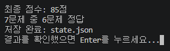</a></p>

**정답 확인:** [is_correct()](quiz.py)에서 입력한 답과 정답을 `==`로 비교.

**점수 계산:** [계산 코드](quiz_game.py)에서 `score = correct * 100 // total`로 정답 비율을 100점 기준 점수로 계산. 소수점 아래는 버림.

`play()`로 문제 출제, `Quiz.is_correct()`로 선택 번호와 정답 비교. 맞힌 개수로 점수 계산. 예: 5문제 중 4문제 정답이면 80점.

### 3-2. 퀴즈 추가

[add_quiz() 코드](quiz_game.py) → 문제 입력 → 보기 4개 입력 → 정답 번호 입력 → 새 `Quiz` 생성 → JSON 저장

<p><a href="docs/screenshots/add_quiz.png">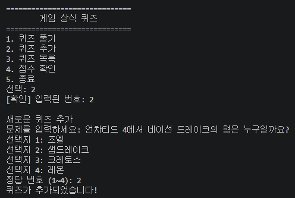</a></p>


문제·보기 4개·정답 번호 입력 → 새 `Quiz` 객체 생성 → 목록 추가 → JSON 파일 저장.
### 3-3. 퀴즈 목록

[show_list() 코드](quiz_game.py) → `for` 반복문으로 문제 번호와 제목 출력. 등록된 문제가 없을 때도 안내.

<p><a href="docs/screenshots/list.png">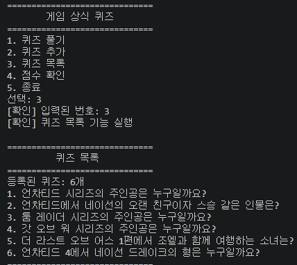</a></p>


`for`로 저장된 문제를 차례로 확인해 번호와 제목 출력. 등록된 문제가 없으면 안내.
### 3-4. 최고 점수 확인

[최고 점수 비교](quiz_game.py) → 기존 점수보다 높으면 갱신 → [메뉴 4번](main.py)에서 출력

<p><a href="docs/screenshots/score.png"></a></p>


이번 점수가 기존 최고 점수보다 높으면 최고 점수 갱신. 메뉴 4번에서 확인.
## 4. 입력 오류 및 안전 종료

| 입력 상황 | 처리 |
|---|---|
| 앞뒤 공백 | `.strip()`으로 제거 |
| 빈칸·문자(`abc`) | 안내 후 다시 입력 |
| 허용 범위 밖 숫자 | 범위 안내 후 다시 입력 |
| `Ctrl+C`·`EOFError` | 종료 안내, `finally`에서 가능한 데이터 저장 |

메뉴와 정답의 숫자 입력은 [read_number()](main.py)에서 확인. [종료 처리](main.py)에서 데이터 저장.

<p><a href="docs/screenshots/safe_exit.png">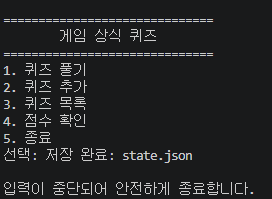</a></p>


빈칸·문자·범위 밖 입력 시 안내 후 `while`로 재입력. 숫자 변환 오류는 `try/except`로 처리. 입력 중단 시 가능한 데이터 저장 후 안전 종료.

## 5. JSON 저장 및 복구

- 저장 위치: 프로젝트 폴더의 `state.json` / 인코딩: UTF-8
- [save_data()](quiz_game.py)의 `json.dump()`: 저장 / [load_data()](quiz_game.py)의 `json.load()`: 불러오기
- 저장 내용: `quizzes`(문제 목록), `best_score`(최고 점수)
- 첫 실행에 파일이 없으면 기본 문제 5개로 시작. 파일이 손상되면 안내 후 기본 데이터로 복구
- `.gitignore`로 `state.json` 제외. 각자 저장한 문제와 점수는 GitHub에 업로드하지 않음

**데이터 구조 예시**

```json
{
  "quizzes": [
    {
      "question": "언차티드의 주인공은?",
      "choices": ["네이선 드레이크", "조엘", "크레토스", "레온"],
      "answer": 1
    }
  ],
  "best_score": 80
}
```

**파일 확인:** `Get-Content .\state.json -Encoding UTF8`

**실행 증거 — JSON 저장과 복구**

저장한 데이터를 다시 불러온 화면:

<p><a href="docs/screenshots/restart.png">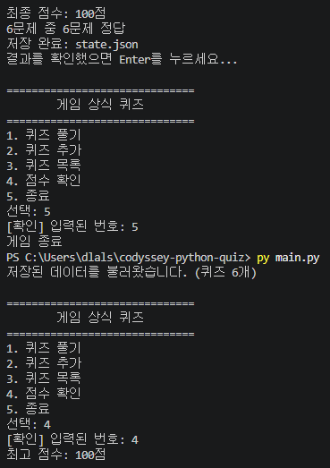</a></p>

저장 파일이 손상되었을 때 복구한 화면:

<p><a href="docs/screenshots/json_recovery.png">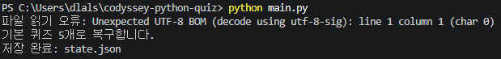</a></p>

JSON 파일에 실제 저장된 내용:

<p><a href="docs/screenshots/json_save.png">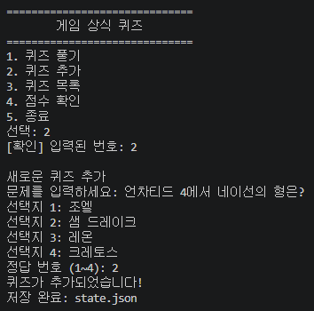</a></p>


`json.dump()`로 퀴즈·최고 점수 저장, `json.load()`로 재실행 시 불러오기. 저장 파일이 없거나 손상되면 기본 문제로 시작·복구.
## 6. Git / GitHub 실습

- 기능별 커밋 **10개 이상** 기록
- 별도 브랜치 작업 후 `main` 병합
- 저장소 복제 후 README 변경·업로드, 원래 폴더에서 `pull`로 반영 확인

**과제 필수 Git 명령어 7종**

| 명령어 | 사용 목적 |
|---|---|
| `git init` | 로컬 저장소 시작 |
| `git add README.md` | 변경 파일 선택 |
| `git commit -m "설명"` | 변경 내용 기록 |
| `git push origin main` | GitHub에 업로드 |
| `git pull origin main` | GitHub 변경 내용 가져오기 |
| `git checkout main` | `main` 브랜치로 이동 |
| `git clone 저장소주소` | 다른 폴더에 저장소 복제 |

**복제 실습 순서:** 별도 폴더에 `clone` → 복제 폴더에서 README 수정 → `add`·`commit`·`push` → 원래 폴더에서 `pull` → 수정된 내용 확인.

**브랜치 생성 및 이동**

<p><a href="docs/screenshots/git_checkout.png">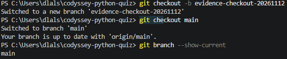</a></p>

**브랜치 병합**

<p><a href="docs/screenshots/git_merge.png">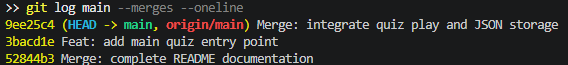</a></p>

**커밋 기록**

<p><a href="docs/screenshots/git_log.png">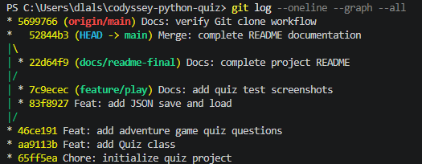</a></p>

**복제한 폴더에서 README 수정 후 commit·push**

<p><a href="docs/screenshots/git_clone_push.png">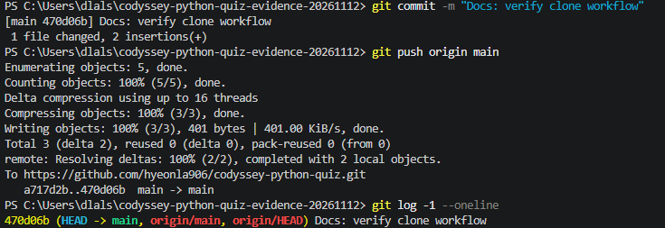</a></p>

**원래 폴더에서 pull 후 변경 확인**

<p><a href="docs/screenshots/git_pull_verified.png">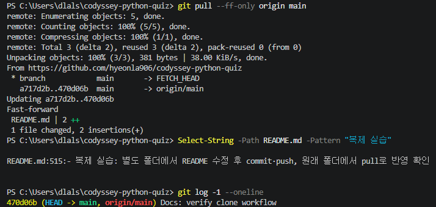</a></p>

**저장소 복제**

<p><a href="docs/screenshots/git_clone.png">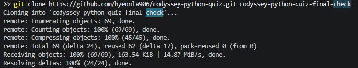</a></p>

**Git 기록 확인:** `git status` / `git branch --show-current` / `git log --oneline --graph --all` / `git remote -v`

Git으로 기능별 변경 기록, 별도 브랜치 작업 후 `main` 병합. `clone`으로 복제해 수정·업로드한 뒤 원래 폴더에서 `pull`로 반영 확인.

## 7. 프로젝트 파일 구성

```text
codyssey-python-quiz/
├─ main.py              메뉴·입력·종료
├─ quiz.py              Quiz 클래스
├─ quiz_game.py         QuizGame 클래스·JSON 저장
├─ state.json           실행 시 생성 (Git 제외)
├─ .gitignore           Git 제외 파일 설정
├─ README.md            과제 설명
├─ docs/screenshots/    실행 증거 사진
└─ logs/verified/       실습 기록
```

**GitHub:** https://github.com/hyeonla906/codyssey-python-quiz

