# 게임 상식 퀴즈

Python으로 만든 터미널 퀴즈 게임  

- **주제:** 언차티드, 툼 레이더, 갓 오브 워, 더 라스트 오브 어스
- **선정 이유:** 평소 익숙한 게임을 주제로 선택. 문제 내용보다 Python 기능 익히기에 집중
- **구현 내용:** 퀴즈 풀기·추가·목록·점수 확인·종료 + 보너스 5개

## 1. 개발 환경과 실행

| 항목 | 사용 환경 |
|---|---|
| 운영체제 / 터미널 | Windows / PowerShell |
| 작성 도구 | VS Code |
| 언어 | Python 3.10 이상 |
| 사용 모듈 | `json`, `random`, `datetime`, `pathlib` (Python 기본 제공) |
| 버전 관리 | Git / GitHub |

**처음 다운로드해서 실행할 때**

```powershell
git clone https://github.com/hyeonla906/codyssey-python-quiz.git
cd codyssey-python-quiz
py --version
py main.py
```

- `git clone` : GitHub 저장소 복사
- `cd` : 프로젝트 폴더로 이동
- `py --version` : Python 버전 확인
- `py main.py` : 게임 실행

이미 프로젝트 폴더에 있다면 `py main.py`만 실행.

**Python 문법 검사**

```powershell
py -m py_compile .\main.py .\quiz.py .\quiz_game.py
```

오류 메시지가 없으면 문법 검사 통과. 실제 기능은 프로그램 실행으로 별도 확인.


## 2. 메뉴와 기본 기능

```text
1. 퀴즈 풀기
2. 퀴즈 추가
3. 퀴즈 목록
4. 점수 확인
5. 퀴즈 삭제 (보너스)
6. 종료
```

`main.py`에서 메뉴 출력과 번호 입력 처리. `quiz_game.py`에서 선택한 기능 실행.

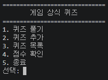

*위 메뉴 사진은 초기 기본 기능 실습 화면. 보너스 삭제 기능 추가 후 현재 메뉴는 6개.*

### 필수 기능 확인

| 기능 | 작업 내용 | 실행 사진 |
|---|---|---|
| **퀴즈 풀기** | 기본 게임 문제 5개 준비. 1~4번 답 선택, 정답·오답과 결과 출력 |  |
| **퀴즈 추가** | 문제·보기 4개·정답 번호 입력. 새 문제 추가 후 저장 |  |
| **퀴즈 목록** | 등록한 문제를 1번부터 순서대로 표시. 문제가 없을 때 안내 |  |
| **최고 점수** | 게임이 끝날 때 점수 비교. 더 높은 점수만 저장 |  |

**입력 오류 처리**

- 앞뒤 공백 제거: `.strip()` 사용
- 빈칸·문자(`abc`)·범위 밖 숫자 입력: 안내 후 다시 입력
- 퀴즈가 0개일 때: 안내 후 메뉴로 이동
- `Ctrl+C` 또는 입력 종료: 안내 출력, 가능한 데이터 저장 후 종료


## 3. 코드 파일과 역할

| 파일 | 역할 |
|---|---|
| `main.py` | 메뉴 출력, 입력값 확인, 종료 처리 |
| `quiz.py` | **Quiz 클래스**: 문제 1개의 내용·보기·정답·힌트 관리 |
| `quiz_game.py` | **QuizGame 클래스**: 문제 목록, 게임 진행, 점수, 저장·불러오기 |

- **클래스:** 같은 모양의 문제를 만드는 설계도
- **Quiz:** 문제 카드 한 장
- **QuizGame:** 여러 문제 카드를 관리하는 게임 진행자
- **함수:** 필요한 일을 따로 묶어 둔 코드. 예: `play()`, `add_quiz()`, `save_data()`

**사용한 Python 기본 문법**

| 문법 | 사용 예 |
|---|---|
| 변수, `int`, `str`, `bool`, `list`, `dict` | 점수·입력 글자·정답 여부·문제 목록·저장 데이터 |
| `if` / `elif` / `else` | 메뉴 번호와 정답 여부 확인 |
| `for` | 문제·보기 목록 출력 |
| `while` | 올바른 입력이 들어올 때까지 반복 |
| `def`, `return` | 기능을 나누고 입력 결과 전달 |
| `try` / `except` / `finally` | 숫자 변환 오류, 파일 오류, 안전 종료 처리 |

## 4. 데이터 저장 — `state.json`

게임 종료 후에도 **문제·최고 점수·플레이 기록 유지**.

- 저장 위치: 프로젝트 폴더의 `state.json`
- 저장 방법: `json.dump()` / 불러오기: `json.load()`
- 한글 저장: UTF-8 사용
- 첫 실행에 파일이 없으면 기본 퀴즈 5개 사용
- 파일이 손상되면 오류 안내 후 기본 퀴즈로 복구
- `state.json`은 `.gitignore`에 등록. 개인 플레이 데이터는 GitHub 업로드 제외

**저장되는 데이터 형태 (예시)**

```json
{
  "quizzes": [
    {
      "question": "언차티드의 주인공은?",
      "choices": ["네이선 드레이크", "조엘", "크레토스", "레온"],
      "answer": 1,
      "hint": "이름에 드레이크가 포함"
    }
  ],
  "best_score": 80,
  "history": [
    {
      "played_at": "2026-11-11T15:00:00+09:00",
      "score": 80,
      "correct": 4,
      "total": 5,
      "hints_used": 0
    }
  ]
}
```

`quizzes`: 문제 목록 / `best_score`: 최고 점수 / `history`: 게임별 플레이 기록

**저장 파일 확인 명령어**

```powershell
Get-Content .\state.json -Encoding UTF8
```

| 저장 확인 | 재실행 후 유지 | 파일 오류 복구 |
|---|---|---|
| 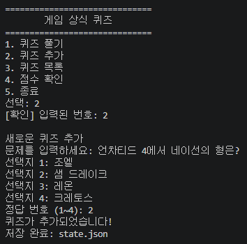 |  |  |

## 5. 보너스 기능 5개

### ① 랜덤 출제

- `self.quizzes.copy()` : 원래 문제 목록 복사
- `random.shuffle(questions)` : 복사한 문제 순서 섞기
- 게임을 다시 시작할 때마다 순서가 달라질 수 있도록 처리

### ② 문제 수 선택

- `len(self.quizzes)` : 등록한 문제 개수 확인
- `read_number()` : 1개부터 전체 문제 수까지 입력받기
- `questions[:count]` : 선택한 수만큼 문제 사용

**실행 사진 — 문제 수 선택과 출제 결과**

<p>
  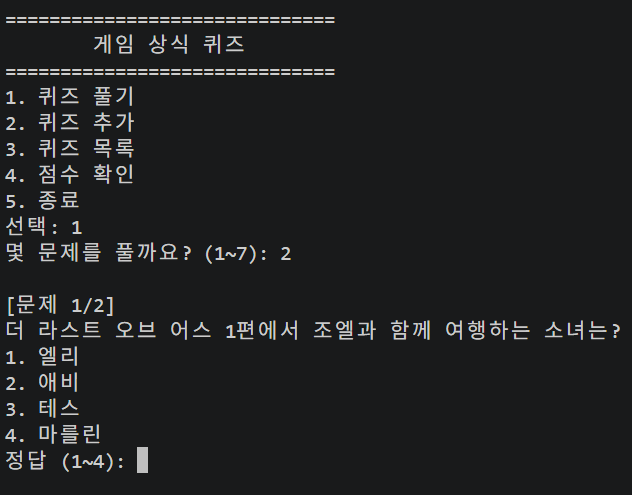
  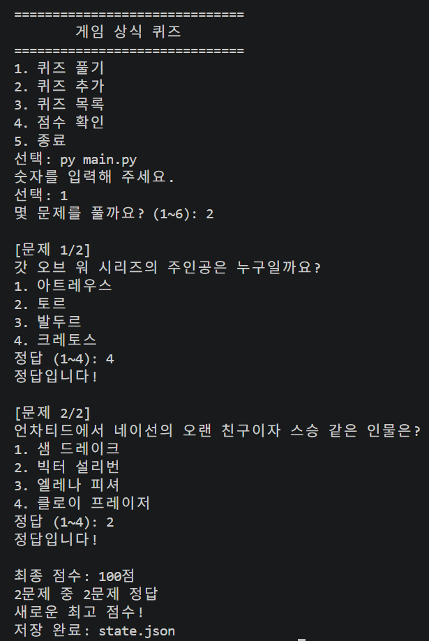
</p>

### ③ 힌트와 점수 감점

- `quiz.py`에 `hint` 추가
- 정답 입력 중 `h` 또는 `H` 입력 시 힌트 표시
- 힌트는 문제당 1회 사용, 사용 횟수 기록
- 힌트 1회당 10점 감점, 최저 0점

```python
score = max(0, correct * 100 // total - hints_used * 10)
```

예: 4문제 중 3문제 정답(75점) + 힌트 1회 → **65점**

**실행 사진 — 힌트 안내 → 사용 → 감점 결과**

<p>
  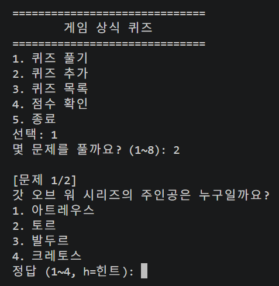
  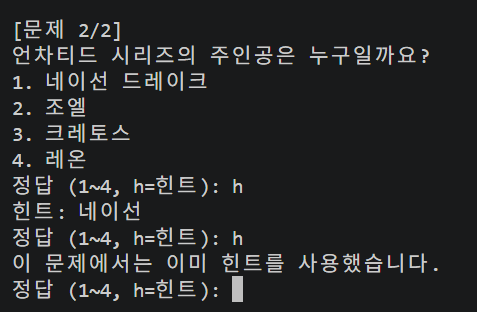
  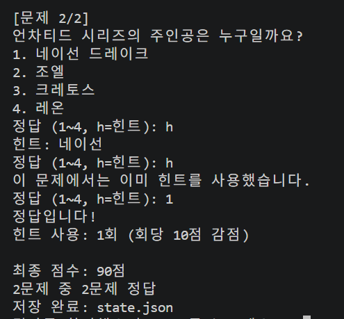
</p>

### ④ 퀴즈 삭제

- 메뉴 `5`에서 삭제할 문제 번호 선택
- `y` 입력 시 삭제, 그 외 입력은 취소
- `.pop(number - 1)` : 선택한 문제 삭제 (Python 목록은 0번부터 시작)
- `save_data()` : 삭제 결과 저장

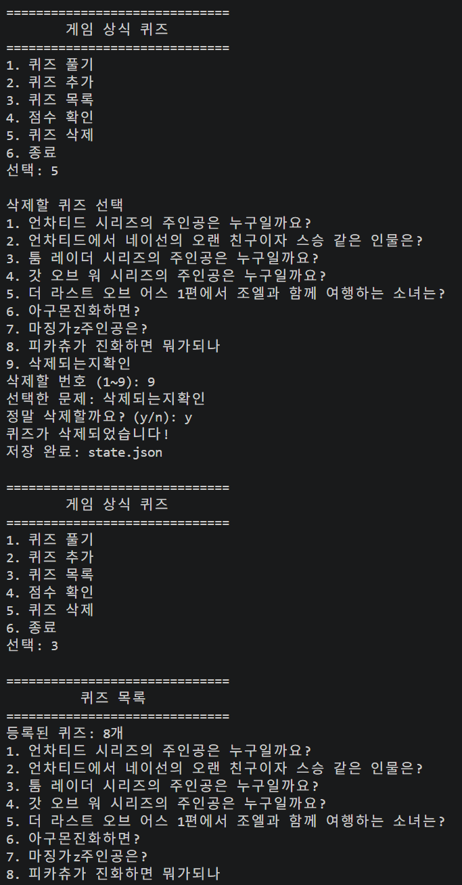

### ⑤ 플레이 기록 저장

- `datetime`으로 게임 날짜·시간 기록
- 매번 **점수·정답 수·푼 문제 수·힌트 사용 횟수**를 `history`에 추가
- `state.json`에 저장. 프로그램 재실행 후에도 기록 유지
- 기록 확인은 JSON 파일에서 진행. 별도 기록 메뉴 없음

```powershell
Get-Content .\state.json -Raw -Encoding UTF8 | ConvertFrom-Json | Select-Object -ExpandProperty history
```

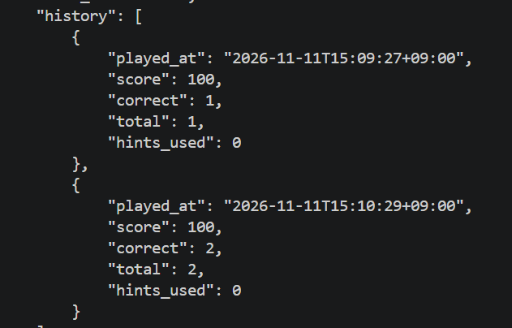

## 6. Git / GitHub 작업 기록

- 기능별 커밋 **10개 이상** 기록
- 별도 브랜치에서 기능 작성 후 `main`으로 병합
- 저장소 `clone`, 변경사항 `pull` 실습
- GitHub에 코드와 README, 증거 사진 관리

| 명령어 | 역할 |
|---|---|
| `git init` | Git 저장소 시작 |
| `git add` | 기록할 파일 선택 |
| `git commit -m "설명"` | 변경 내용 기록 |
| `git branch` / `git checkout` / `git switch` | 브랜치 확인·이동 |
| `git merge` | 브랜치 작업 합치기 |
| `git push` / `git pull` | GitHub에 올리기 / 가져오기 |
| `git clone` | 저장소 복사 |

**Git 기록 확인**

```powershell
git status
git branch --show-current
git --no-pager log --oneline --graph --all -15
git remote -v
```

**실행 사진 — 커밋·브랜치·설정**

<p>
  
  
  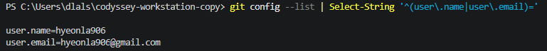
</p>

**실행 사진 — 복제·변경사항 가져오기**

<p>
  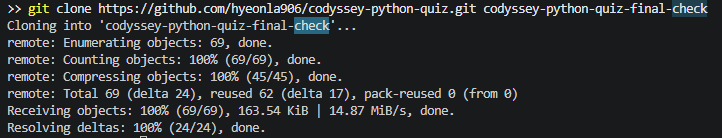
  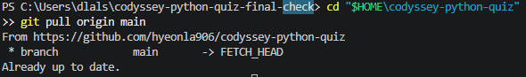
</p>

## 7. 파일 구성

```text
codyssey-python-quiz/
├─ main.py                메뉴·입력·종료
├─ quiz.py                퀴즈 한 문제
├─ quiz_game.py           게임 진행·저장
├─ state.json             실행 후 생성 (Git 제외)
├─ .gitignore             Git에서 제외할 파일
├─ README.md              과제 설명
├─ docs/screenshots/      기본·보너스·Git 실행 사진
└─ logs/verified/         작업 명령 기록
```

**저장소:** https://github.com/hyeonla906/codyssey-python-quiz
