# 게임 상식 퀴즈

Python으로 만든 터미널 퀴즈 게임. 문제를 풀고 추가하거나, 목록과 최고 점수를 확인할 수 있도록 구성.

- **주제:** 언차티드, 툼 레이더, 갓 오브 워, 더 라스트 오브 어스
- **선정 이유:** 익숙한 게임 문제를 사용해 Python 기본 문법과 프로그램 흐름 학습에 집중
- **구현:** 기본 기능 5개(퀴즈 풀기·추가·목록·점수 확인·종료), 보너스 5개

## 1. 개발 환경 및 실행

| 항목 | 내용 |
|---|---|
| 환경 | Windows / PowerShell / VS Code |
| 언어 | Python 3.10 이상 (실습 확인: Python 3.12.8) |
| 라이브러리 | `json`, `random`, `datetime`, `pathlib` (Python 기본 제공) |
| 버전 관리 | Git / GitHub |

```powershell
git clone https://github.com/hyeonla906/codyssey-python-quiz.git
cd codyssey-python-quiz
py main.py
```

- `git clone`: 저장소 복사 / `cd`: 폴더 이동 / `py main.py`: 프로그램 실행
- 문법 검사: `py -m py_compile .\main.py .\quiz.py .\quiz_game.py`

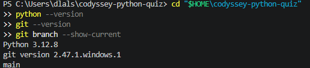

## 2. 파일 구조와 역할

| 파일 | 역할 |
|---|---|
| [main.py](main.py) | 메뉴 표시, 번호 입력, 오류 처리, 종료 |
| [quiz.py](quiz.py) | `Quiz` 클래스 — 문제·보기 4개·정답·힌트 관리 |
| [quiz_game.py](quiz_game.py) | `QuizGame` 클래스 — 출제·추가·목록·점수·JSON 저장 |
| `state.json` | 실행 시 생성되는 퀴즈·점수·플레이 기록 (`.gitignore`로 업로드 제외) |

**구조:** `Quiz`는 문제 한 개, `QuizGame`은 여러 문제와 게임 진행 담당. `main.py`에서 메뉴 선택 후 해당 기능 실행.

## 3. 기본 기능 및 실행 결과

**메뉴:** `1` 퀴즈 풀기 / `2` 퀴즈 추가 / `3` 퀴즈 목록 / `4` 점수 확인 / `5` 퀴즈 삭제(보너스) / `6` 종료

| 기능 | 작업 과정 | 실행 증거 |
|---|---|---|
| **퀴즈 풀기** | `play()` → 문제 수 선택 → 문제 출력 → `is_correct()`로 정답 확인 → 점수 저장 | 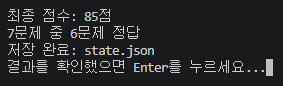 |
| **퀴즈 추가** | `add_quiz()` → 문제·보기 4개·정답 입력 → `Quiz` 생성 → JSON 저장 | 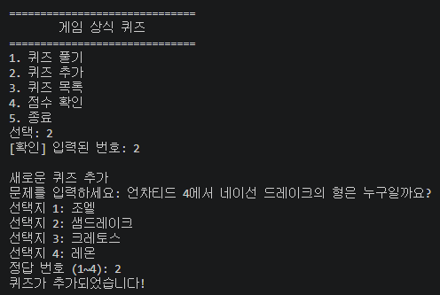 |
| **퀴즈 목록** | `show_list()` → `for` 반복문으로 번호와 문제 출력. 빈 목록도 처리 | 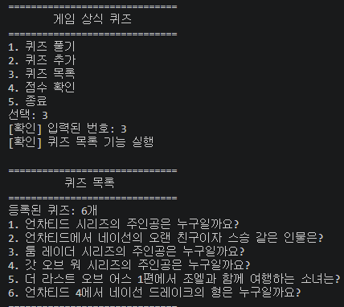 |
| **점수 확인** | 게임 종료 후 최고 점수와 비교. 더 높은 점수만 갱신 |  |

**퀴즈 풀기 흐름:** 메뉴 1번 → 풀 문제 수 입력 → 문제 목록을 복사해 순서 섞기 → 보기 1~4번 선택 → 정답·오답 출력 → 결과 및 최고 점수 저장.

**정답 확인:** `quiz.py`의 `is_correct()`에서 입력한 번호(`choice`)와 저장된 정답(`self.answer`)을 `==`로 비교.

**점수 계산:** 정답 비율을 점수로 바꾸고 힌트 1회당 10점 감점. `max(0, ...)`으로 최저 0점 유지.

## 4. 입력 오류 및 안전 종료

| 입력 상황 | 처리 |
|---|---|
| 앞뒤 공백 | `.strip()`으로 제거 |
| 빈칸·문자(`abc`) | 안내 후 다시 입력 |
| 허용 범위 밖 숫자 | 범위 안내 후 다시 입력 |
| `Ctrl+C`·`EOFError` | 종료 안내, `finally`에서 가능한 데이터 저장 |

숫자 입력은 `read_number()`, 퀴즈 정답과 힌트 입력은 `read_answer()`에서 확인.

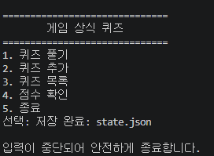

## 5. JSON 저장 및 복구

- 저장 위치: 프로젝트 폴더의 `state.json` / 인코딩: UTF-8
- `json.dump()`: 저장 / `json.load()`: 불러오기
- 저장 내용: `quizzes`(문제 목록), `best_score`(최고 점수), `history`(플레이 기록)
- 첫 실행에 파일이 없으면 기본 문제 5개로 시작. 파일이 손상되면 안내 후 기본 데이터로 복구
- `.gitignore`로 `state.json` 제외. 각자 실행한 기록은 GitHub에 업로드하지 않음

**데이터 구조 예시**

```json
{
  "quizzes": [
    {
      "question": "언차티드의 주인공은?",
      "choices": ["네이선 드레이크", "조엘", "크레토스", "레온"],
      "answer": 1,
      "hint": "이름에 드레이크가 포함"
    }
  ],
  "best_score": 80,
  "history": []
}
```

**파일 확인:** `Get-Content .\state.json -Encoding UTF8`

| 저장·재실행 확인 | 파일 오류 복구 |
|---|---|
| 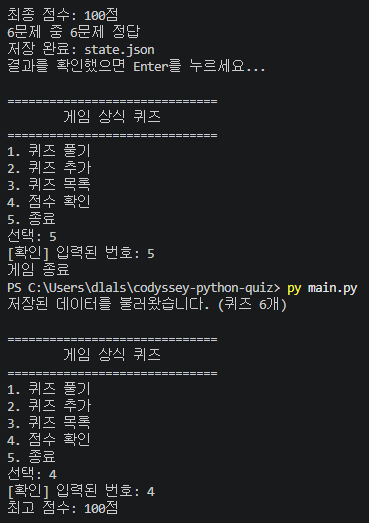 | 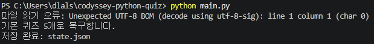 |

추가 증거: [JSON 저장 화면](docs/screenshots/json_save.png)

## 6. 보너스 기능

| 기능 | 구현 방법 | 실행 증거 |
|---|---|---|
| **랜덤 출제** | `self.quizzes.copy()` 후 `random.shuffle()`로 출제 순서 변경 | [퀴즈 결과](docs/screenshots/bonus_count_result.png) |
| **문제 수 선택** | `len()`으로 전체 개수 확인, `questions[:count]`로 원하는 수만큼 출제 | [문제 수 선택](docs/screenshots/bonus_count_select.png) |
| **힌트·감점** | `h` 입력 시 힌트 표시(문제당 1회), 1회당 10점 감점 | [힌트 사용](docs/screenshots/bonus_hint_show.png) · [감점 결과](docs/screenshots/bonus_hint_score.png) |
| **퀴즈 삭제** | 번호 선택 → `y` 확인 → `.pop(number - 1)` → JSON 저장 | [삭제 결과](docs/screenshots/bonus_delete_result.png) |
| **플레이 기록** | `datetime`으로 날짜·시간 기록, 점수·정답 수·힌트 사용을 `history`에 저장 | [기록 저장](docs/screenshots/bonus_history_result.png) |

힌트는 등록할 때 입력한 문제에서 사용 가능. `history`는 별도 메뉴 없이 `state.json`에서 확인.

## 7. Git / GitHub 실습

- 기능별 커밋 **10개 이상** 기록
- 별도 브랜치 작업 후 `main` 병합
- 저장소 복제 후 README 변경·업로드, 원래 폴더에서 `pull`로 반영 확인

**과제 필수 Git 명령어 7종**

| 명령어 | 사용 목적 |
|---|---|
| `git init` | 로컬 저장소 시작 |
| `git add README.md` | 변경 파일 선택 |
| `git commit -m "설명"` | 변경 내용 기록 |
| `git push origin main` | GitHub에 업로드 |
| `git pull origin main` | GitHub 변경 내용 가져오기 |
| `git checkout main` | `main` 브랜치로 이동 |
| `git clone 저장소주소` | 다른 폴더에 저장소 복제 |

**복제 실습 순서:** 별도 폴더에 `clone` → 복제 폴더에서 README 수정 → `add`·`commit`·`push` → 원래 폴더에서 `pull` → 수정된 내용 확인.

| 브랜치 생성·이동 | 브랜치 병합 | 커밋 기록 |
|---|---|---|
| 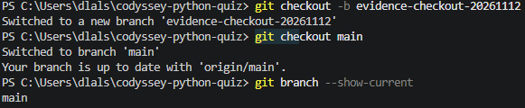 | 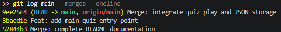 | 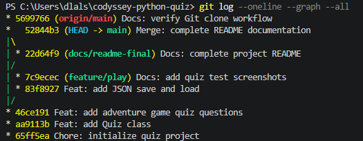 |

| 복제 폴더에서 수정·업로드 | 기존 폴더에서 변경 내용 확인 |
|---|---|
| 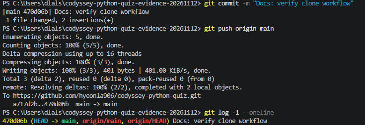 | 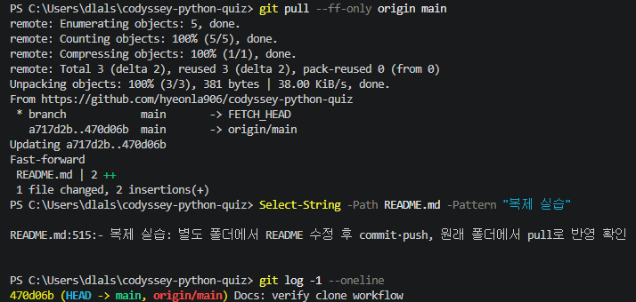 |

추가 증거: [저장소 복제](docs/screenshots/git_clone.png)

**Git 기록 확인:** `git status` / `git branch --show-current` / `git log --oneline --graph --all` / `git remote -v`

## 8. 프로젝트 파일 구성

```text
codyssey-python-quiz/
├─ main.py              메뉴·입력·종료
├─ quiz.py              Quiz 클래스
├─ quiz_game.py         QuizGame 클래스·JSON 저장
├─ state.json           실행 시 생성 (Git 제외)
├─ .gitignore           Git 제외 파일 설정
├─ README.md            과제 설명
├─ docs/screenshots/    실행 증거 사진
└─ logs/verified/       보너스 실습 기록
```

**GitHub:** https://github.com/hyeonla906/codyssey-python-quiz
